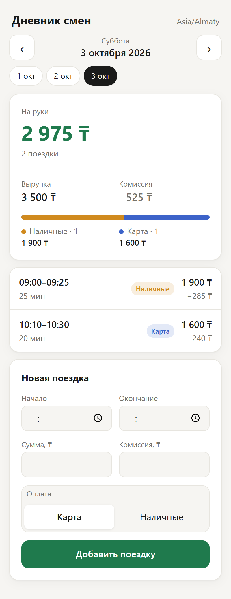
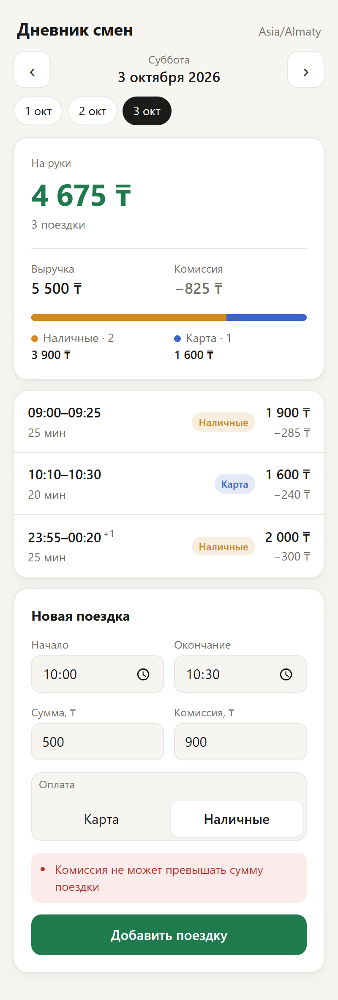
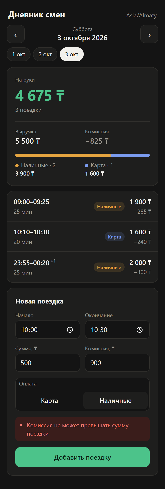

# Дневник смен водителя

Веб-приложение для учёта поездок водителя такси. Показывает сводку за день и список поездок, умеет переключать дни и добавлять новые поездки. Повторная отправка той же поездки дубль не создаёт.

Стек: FastAPI + SQLite на сервере, React + TypeScript + Vite на клиенте.

<p>
  
  
  
</p>

## Запуск

### Docker

```bash
docker compose up --build
```

Откройте http://localhost:8080. Swagger сервера в контейнер наружу не проброшен; для него используйте локальный запуск.

При первом старте база заполняется поездками из [backend/data/trips.json](backend/data/trips.json). База лежит в volume `trips-data` и переживает перезапуск. Сбросить её можно командой `docker compose down -v`.

### Локально

Нужны Python 3.12+ и Node.js 20+.

```bash
# сервер, http://localhost:8000, Swagger на /docs
cd backend
python -m venv .venv
.venv/bin/pip install -r requirements-dev.txt     # Windows: .venv\Scripts\pip
.venv/bin/uvicorn app.main:app_from_env --factory --reload

# клиент, http://localhost:5173, /api проксируется на :8000
cd frontend
npm install
npm run dev
```

Переменные окружения сервера:

| Переменная | По умолчанию | Что задаёт |
|---|---|---|
| `APP_TIMEZONE` | `Asia/Almaty` | Часовой пояс, по которому поездки делятся на дни |
| `DATA_DIR` | `backend/data` | Папка с файлом базы `trips.db` |
| `SEED_PATH` | `backend/data/trips.json` | Начальные данные, загружаются только в пустую базу |

### Тесты

```bash
cd backend && .venv/bin/pytest -v
cd frontend && npm test
```

Тесты запускаются в GitHub Actions на каждый push.

## API

| Метод | Путь | Ответ |
|---|---|---|
| `GET` | `/api/days` | Пояс и список дней, в которых есть поездки |
| `GET` | `/api/days/{YYYY-MM-DD}` | Сводка и поездки за день, отсортированные по началу |
| `POST` | `/api/trips` | `201` поездка создана, `200` повтор уже сохранённой поездки, `409` конфликт, `422` неверные данные |

Пример ответа `GET /api/days/2026-10-01` для двух поездок из задания:

```json
{
  "date": "2026-10-01",
  "timezone": "Asia/Almaty",
  "summary": {
    "trips_count": 2,
    "revenue": 3900,
    "commission": 585,
    "net": 3315,
    "cash": {"count": 1, "amount": 1500},
    "card": {"count": 1, "amount": 2400}
  },
  "trips": [...]
}
```

## Решения

**Сводка.** «На руки» считается как выручка минус комиссия. Выручка дополнительно разбита на наличные и карту: число поездок и сумма по каждому способу оплаты. Суммы хранятся в целых тенге, поэтому ошибок округления нет.

**Граница дня.** Поездка относится к дню, в который она началась, по часовому поясу водителя (`APP_TIMEZONE`). Поездка 23:40–00:10 попадает в день начала, а в списке у времени окончания стоит пометка `+1`. Время во входных данных может прийти с любым смещением: `05:00Z` и `10:00+05:00` считаются одним моментом.

**Проверка данных.** Сумма должна быть целым числом больше нуля. Комиссия должна быть от 0 до суммы поездки. Окончание должно быть строго позже начала. Время обязательно со смещением, потому что без него нельзя определить день. Способ оплаты принимает только `cash` или `card`. Ошибки возвращаются с кодом `422`, и клиент показывает их на русском под формой.

**Защита от дублей** работает на двух уровнях:

1. `id` поездки это ключ идемпотентности, его генерирует клиент. Повтор с тем же `id` и теми же данными возвращает `200` и уже сохранённую поездку, новая запись не появляется. Тот же `id` с другими данными возвращает `409`, сохранённая поездка не меняется.
2. Водитель не может везти двух пассажиров одновременно, поэтому поездка, которая пересекается по времени с уже сохранённой, отклоняется с `409`. Это ловит повтор, у которого клиент по ошибке сгенерировал новый `id`. Поездки встык (одна кончилась в 09:20, другая началась в 09:20) разрешены.

Проверка и вставка выполняются в одной транзакции `BEGIN IMMEDIATE`, поэтому параллельные одинаковые запросы не создают дубль и не падают с ошибкой. Это проверяет отдельный тест: 12 потоков одновременно отправляют одну поездку.

В клиенте форма создаёт `id` один раз и держит его до успешного сохранения. Повторный клик, ретрай после обрыва сети или повторная отправка после ошибки идут с тем же `id`. Пока запрос выполняется, кнопка заблокирована.

**Хранилище.** SQLite: уникальность `id` и ограничения на суммы проверяет сама база, а исходный JSON служит начальными данными. Моменты времени хранятся как целые микросекунды UTC, поэтому сравнение и поиск пересечений не зависят от формата строки.

## Тесты

| Файл | Что проверяет |
|---|---|
| [test_summary.py](backend/tests/test_summary.py) | Расчёт сводки на данных из задания, пустой день, несколько поездок одного типа, определение дня по поясу водителя |
| [test_api.py](backend/tests/test_api.py) | Сводку и список через API, повторную отправку, тот же момент в другом смещении, конфликт `id`, пересечения и поездки встык, гонку параллельных запросов, поездку через полночь, сортировку |
| [test_validation.py](backend/tests/test_validation.py) | Все правила проверки данных, обязательные поля, неверную дату в URL |
| [time.test.ts](frontend/src/time.test.ts) | Перевод времени из формы в ISO со смещением пояса, переход через месяц и год, длительность через полночь |

Тесты проверялись мутациями: если убрать проверку пересечений, сравнение данных при повторе, вычитание комиссии или `BEGIN IMMEDIATE`, соответствующие тесты падают.

## Структура

```
backend/
  app/models.py        модели и правила проверки
  app/summary.py       расчёт сводки и дня смены
  app/repository.py    SQLite, идемпотентная вставка, поиск пересечений
  app/main.py          HTTP API
  data/trips.json      начальные данные
  tests/
frontend/
  src/api.ts           клиент API и разбор ошибок
  src/time.ts          работа с датами и часовым поясом
  src/components/      навигация по дням, сводка, список, форма
docker-compose.yml
```
